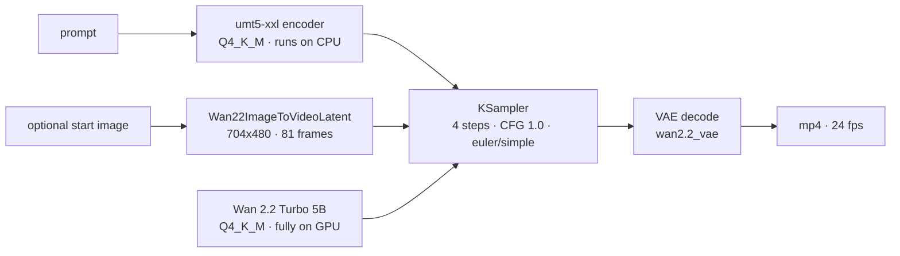

# ComfyUI on every system

Which model to run on **your** card — 4 GB laptops, 8 GB desktops, 24 GB workstations, AMD, Apple,
CPU — with the file sizes, the token limits, the launch flags and the measured numbers behind each
recommendation.

The repo is two things:

1. **A model matrix.** Every tier from 4 GB to 48 GB, image and video, with the quant that fits,
   the encoder that does not, and the output you get. → [docs/model-matrix.md](docs/model-matrix.md)
2. **A working 6 GB install.** Wan 2.2 TI2V-5B Turbo text-to-video, image-to-video, a Wan 2.1 VACE
   character swap and a 1080p export path, measured end to end on a gaming laptop. No cloud, no
   full-precision checkpoints, ~9 GB of models.

```text
RTX 4050 Laptop (6 GB) · Ryzen 7 7435HS · 16 GB RAM · Windows 11 · ComfyUI 0.46.0 · torch 2.14.1+cu130
704x480 · 81 frames · 4 steps  ->  ~2.5 min per 3.4 s clip
```

---

## Start here: pick your tier

| VRAM | Best image model | Best video model | Read |
| --- | --- | --- | --- |
| 4 GB | SD 1.5 (2.1 GB) or Anima Q4 | Wan 2.1 1.3B Q4 + CausVid | [matrix](docs/model-matrix.md#image-models-by-tier) |
| **6 GB** | FLUX.2 Klein 4B distilled, SDXL Q8 | **Wan 2.2 TI2V-5B Q4 — this repo** | [hardware](docs/hardware.md) |
| 8 GB | Z-Image Turbo Q8, FLUX.2 Klein 4B base | Wan 2.2 5B Q5/Q6 at 832×480 | [matrix](docs/model-matrix.md#video-models-by-tier) |
| 12 GB | Z-Image Turbo fp8, FLUX.1 dev Q8 | Wan 2.2 5B Q8 at 121 frames | [matrix](docs/model-matrix.md) |
| 16 GB | HiDream I1 fp8, Z-Image base | HunyuanVideo 1.5 fp8, Wan 2.2 A14B Q4 | [matrix](docs/model-matrix.md) |
| 24 GB | Qwen-Image fp8, FLUX.2 dev | Wan 2.2 A14B fp8, Mochi 1 | [matrix](docs/model-matrix.md) |
| 32–48 GB | Qwen-Image BF16, FLUX.2 dev BF16 | LTX-2 / 2.3, Wan 2.2 A14B BF16 | [matrix](docs/model-matrix.md) |

Three numbers decide every row:

```text
VRAM needed  ≈  weights on disk × 1.6     (video, 480p, after offload)
VRAM needed  ≈  weights on disk + 1.5 GB  (image, 1 MP)
RAM needed   ≈  dequantised text encoder + 6 GB
```

And one trap: **the text encoder is often bigger than the model.** On 6 GB the umt5 encoder is 4.66 GB
dequantised, does not fit next to the UNet, and accounts for 75–80% of a clip's wall clock.

---

## Tokens: how many your prompt can use

| Encoder | Models | Max tokens |
| --- | --- | --- |
| CLIP-L / G | SD 1.5, SDXL, FLUX.1 | 77 (hard limit) |
| T5-XXL | FLUX.1, SD 3.5, Chroma | 512 |
| UMT5-XXL | Wan 2.1 / 2.2, VACE | 512 |
| Qwen2.5-VL 7B | Qwen-Image, HunyuanVideo 1.5, LongCat, Kandinsky 5 | 512 |
| Qwen3 4B / 8B | Z-Image, FLUX.2 Klein, Anima | 512 |
| Mistral Small 3.1 | FLUX.2 dev | 512 |
| Gemma 3 12B | LTX-2 / 2.3 | 512 |
| T5 (CogVideoX) | CogVideoX | 226 |
| T5 (Mochi) | Mochi 1 | 256 |

A 4-token prompt still costs ~55 s of encoder time on 6 GB; a 500-token prompt costs ~130 s. The
weights are the fixed cost, the tokens are the second term. Full breakdown, including what a token
costs at each tier: **[docs/tokens.md](docs/tokens.md)**.

---

## What you get out

| Tier | Typical output | Duration | Size |
| --- | --- | --- | --- |
| 4 GB | 512×288 h264 MP4 | 1.4–2.0 s | 0.5–1.5 MB |
| **6 GB** | **704×480 h264 MP4** | **3.4 s** | **1.5–3 MB** |
| 12 GB | 832×480, 121 frames | 5.0 s | 3–6 MB |
| 24 GB | 1280×720 | 3.4–5.0 s | 4–9 MB |
| 32 GB+ | 1280×720 + audio (LTX-2) | 5.0 s | 8–20 MB |
| 1080p path | 1920×1080, upscaled | 3.4 s | 8–25 MB |

Renders are gitignored — the repo stays ~100 KB and clones instantly. Specs, sample prompts and what
each output is worth: **[docs/outputs.md](docs/outputs.md)**.

---

## Website

A single-page field guide in [`docs/`](docs/index.html) — a Comfy-style dark UI (ink `#211927`,
electric yellow `#f2ff59`, node-graph hero), dependency-free, no build step, small enough to open on
the same laptop you are trying to configure. One OFL font (Space Grotesk, 22 KB) and nothing else.

- a **VRAM picker** (4 / 6 / 8 / 12 / 16 / 24 GB) that changes the quant, encoder placement,
  resolution, frame count and launch flags
- the **model matrix** for image and video, the **token limits**, and the **output specs**
- all **twelve elements** of a Wan graph, from the text encoder to the upscaler
- the **VRAM budget**, the measured benchmarks, the four workflows, the install steps, and the
  failures you will actually hit

Run it locally without a server by opening `docs/index.html`, or serve the folder:

```powershell
python -m http.server 8765 --directory .\docs
# then open http://127.0.0.1:8765/
```

GitHub Pages: Settings → Pages → Source `main`, folder `/docs`. No Actions or build step required.

---

## What you get in the 6 GB build

| Workflow | Status | What it does |
| --- | --- | --- |
| `Wan2.2-Turbo-5B-TextToVideo` | verified | prompt → clip, fastest path |
| `Wan2.2-Turbo-5B-GGUF` | verified graph | start image + prompt → animated clip |
| `Wan2.1-VACE-1.3B-CharacterSwap` | verified | carries a character from one photo into a new scene |
| `Wan2.2-Turbo-5B-TextToVideo-1080p` | experimental | 480p generation, 4× UltraSharp, 1920×1080 file |
| `scripts/faceswap` | tested | per-frame face swap on an existing video, then 1080×1920 upscale |

The two Turbo graphs are the official ComfyUI templates cut down to what actually fits: GGUF
loaders, 704×480, 81 frames, and no second text-encoder pass (CFG 1.0 ignores the negative prompt).

---

## Why this is not just "install the template"

The ComfyUI template browser wants full-precision safetensors: the 5B model alone is ~10 GB, the 14B
models are 28–60 GB, and the VACE template pulls a 14B checkpoint. On a 6 GB card those never load.
The buttons labelled **"Install missing models"** download tens of GB you cannot run.

Everything here is quantised instead:

| Component | File | Size |
| --- | --- | --- |
| Video model | `Wan22-Turbo-Q4_K_M.gguf` | 3.28 GiB |
| Text encoder | `umt5-xxl-encoder-Q4_K_M.gguf` | 3.40 GiB |
| VAE | `wan2.2_vae.safetensors` | 1.31 GiB |
| Character swap model | `Wan21-VACE-1.3B-Q8_0.gguf` | 2.14 GiB |
| Wan 2.1 VAE | `wan_2.1_vae.safetensors` | 242 MiB |
| Upscaler | `4x-UltraSharp.safetensors` | 64 MiB |

Full download instructions and alternate quants: [docs/models.md](docs/models.md).

---

## How a clip is made



Two facts drive every number in this repo:

1. **The UNet fits, the text encoder does not.** The 5B Q4 model is 3.36 GB and stays resident on the
   GPU (5.7 GB peak with latents). The umt5 encoder is 4.66 GB in fp16, so ComfyUI runs it from
   system RAM. That pass costs ~60–120 s and repeats for every new prompt.
2. **Resolution is quadratic, and 480p is the trained size.** 704×480 is the sweet spot;
   832×480 costs almost twice as much for +18% pixels and hits the VRAM ceiling.

Numbers: [docs/performance.md](docs/performance.md). Hardware tiers: [docs/hardware.md](docs/hardware.md).
Everything else ComfyUI can run: [docs/model-matrix.md](docs/model-matrix.md).

---

## Quick start (Windows)

Prerequisites: NVIDIA GPU with **6 GB+ VRAM**, **16 GB RAM**, ~35 GB free disk, Windows 10/11.

```powershell
git clone https://github.com/OVAIS69/comfy-on-every-system.git
cd comfy-on-every-system

# 1. ComfyUI portable: download the 7z from
#    https://github.com/comfyanonymous/ComfyUI/releases
#    and extract it here so you have .\ComfyUI_windows_portable\python_embeded\python.exe

# 2. GGUF loader nodes
git clone --depth 1 https://github.com/city96/ComfyUI-GGUF.git `
    .\ComfyUI_windows_portable\ComfyUI\custom_nodes\ComfyUI-GGUF
.\ComfyUI_windows_portable\python_embeded\python.exe -m pip install `
    -r .\ComfyUI_windows_portable\ComfyUI\custom_nodes\ComfyUI-GGUF\requirements.txt

# 3. Models (~9 GB, resumable)
powershell -ExecutionPolicy Bypass -File .\scripts\download_models.ps1

# 4. Workflows into the ComfyUI sidebar
Copy-Item .\workflows\*.json `
    .\ComfyUI_windows_portable\ComfyUI\user\default\workflows\

# 5. Start
.\scripts\run_comfyui.bat
```

Open http://127.0.0.1:8188, pick a workflow in the **Workflows** sidebar, edit the prompt, press
**Run**. Outputs land in `ComfyUI_windows_portable\ComfyUI\output\video\`.

Detailed guide, including Linux/macOS: [docs/installation.md](docs/installation.md).

---

## Measured results

All figures are wall-clock for the whole job, measured server-side on the laptop above.
81 frames = 3.4 s at 24 fps.

| Resolution | Frames | Steps | Time | Note |
| --- | --- | --- | --- | --- |
| 512×288 | 81 | 4 | 88 s | ~260p, soft but usable for drafts |
| **704×480** | **81** | **4** | **152–174 s** | native 480p, recommended |
| 832×480 | 81 | 4 | 293–296 s | 16:9, VRAM ceiling, poor value |
| 1920×1080 | - | - | not possible | needs ~20 GB VRAM to sample |

| Launch flags | Sampling | Peak VRAM |
| --- | --- | --- |
| `--lowvram --reserve-vram 0.4` | 24.7 s/step | 3.8 GB |
| `--reserve-vram 0.2` (default here) | 4.5 s/step | 5.7 GB |

Character swap (VACE 1.3B, 20 steps, CFG 6): **704×480 / 33 frames = ~300 s**, 11.1 s/step.

---

## Repository layout

```text
docs/
  model-matrix.md    every model, every tier, 4 GB to 48 GB — image and video
  tokens.md          token limits per encoder, what a token costs
  outputs.md         file specs, sample prompts, what each tier produces
  hardware.md        6 / 8 / 12 / 16 / 24 GB, AMD, Apple, CPU
  installation.md    from-zero install, Windows + Linux/macOS
  models.md          the 6 GB build: every file, source URL, quant choices
  workflows.md       node-by-node tour of the four graphs
  performance.md     benchmark tables and methodology
  troubleshooting.md OOM, missing nodes, black video, slow encoder
  faceswap.md        ONNX face swap + upscale pipeline
  faq.md             short answers to the recurring questions
  index.html         the single-page site
workflows/           the four ComfyUI graphs (drag-and-drop / sidebar)
scripts/
  download_models.ps1      resumable downloader for all models
  run_comfyui.bat          fast launcher (UNet fully on GPU)
  run_comfyui_lowvram.bat  fallback launcher
  build_workflows.py       regenerates the workflow JSONs
  test_wan.ps1             submit a T2V job through the HTTP API
  test_vace.ps1            submit a character-swap job
  test_1080p.ps1           submit the 480p -> 1080p job
  faceswap/                swap_video.py, upscale_video.py
```

---

## Character swap and face swap

These solve different problems:

- **`Wan2.1-VACE-1.3B-CharacterSwap`** generates a *new* video from a prompt plus one reference
  photo. Identity is carried loosely (face, hair, clothing vibe). Runs inside ComfyUI.
- **`scripts/faceswap`** takes an *existing* video and swaps the face on every frame with
  `inswapper_128` ONNX, then upscales. No diffusion, so pose and motion are preserved exactly.

Wan 2.2 **Animate** would do a much better job than either, but it is a 14B model and does not fit
in 6 GB at any usable quantisation.

Details: [docs/faceswap.md](docs/faceswap.md).

---

## Honest limits

- **Native 1080p is out of reach on 6 GB.** 1920×1080 sampling needs roughly 20 GB VRAM. The 1080p
  workflow generates at 864×480, upscales 4×, and rescales to 1920×1080. It is a true 1080p file
  but the detail is interpolated, not invented.
- **The text encoder dominates short clips.** On 81 frames it is 40–60% of the wall clock. A
  smaller encoder quant or a free GB of VRAM is the biggest single win.
- **Only the 6 GB video build is measured.** The 4 / 8 / 12 / 16 / 24 / 48 GB rows in the matrix are
  built from published file sizes and vendor minimums. They are labelled as estimates.
- **Timings are one machine.** Your 4050/4060/3060 will differ. The ratios (resolution, frames,
  steps) transfer; absolute seconds do not.
- **VACE at 1.3B is not a face-lock.** Expect "same character type", not "same person".
- **Face swap is 128 px.** `inswapper_128` is trained on photographs. Stylised 3D renders and heavy
  filters produce weak likeness; profile shots and occlusions fail.

---

## Licenses

Code and prose in this repo: MIT (see [LICENSE](LICENSE)). Model weights are **not** included and
keep their own licenses:

- Wan 2.2 / 2.1 weights: Apache-2.0 (Alibaba Wan).
- `umt5-xxl` encoder: Apache-2.0 (Google), GGUF conversion by city96.
- `4x-UltraSharp`: check the model card (Kim2091) before commercial use.
- `inswapper_128`: research use only, not licensed for commercial deployment.
- Qwen-Image, FLUX.2, LTX-2, HunyuanVideo and the rest carry their own (mostly Apache-2.0 or
  non-commercial) terms — check before shipping anything.

---

## Credits

Built on the work of [ComfyUI](https://github.com/comfyanonymous/ComfyUI),
[city96/ComfyUI-GGUF](https://github.com/city96/ComfyUI-GGUF), the
[Wan](https://github.com/Wan-Video/Wan2.1) team, [hum-ma](https://huggingface.co/hum-ma) and
[calcuis](https://huggingface.co/calcuis) for the GGUF quants, [city96](https://huggingface.co/city96)
for the encoder GGUF, and [insightface](https://github.com/deepinsight/insightface) for the
face-swap models.
