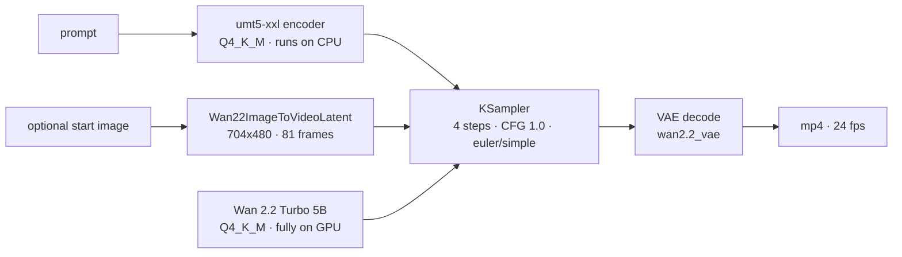

# Wan 2.2 video generation on 6 GB of VRAM

Run **Wan 2.2 TI2V-5B Turbo** text-to-video, image-to-video, a **Wan 2.1 VACE 1.3B** character
swap, and a **1080p export path** in ComfyUI on a gaming laptop with a 6 GB GPU and 16 GB of RAM.
No cloud, no full-precision checkpoints, ~9 GB of models.

This repo is the distilled version of a working install: the exact GGUF files, the four workflow
graphs, the launcher flags, the measured timings, and the mistakes worth avoiding.

```
RTX 4050 Laptop (6 GB) · Ryzen 7 7435HS · 16 GB RAM · Windows 11 · ComfyUI 0.46.0 · torch 2.14.1+cu130
704x480 · 81 frames · 4 steps  ->  ~2.5 min per 3.4 s clip
```

---

## What you get

| Workflow | Status | What it does |
| --- | --- | --- |
| `Wan2.2-Turbo-5B-TextToVideo` | verified | prompt -> clip, fastest path |
| `Wan2.2-Turbo-5B-GGUF` | verified graph | start image + prompt -> animated clip |
| `Wan2.1-VACE-1.3B-CharacterSwap` | verified | carries a character from one photo into a new scene |
| `Wan2.2-Turbo-5B-TextToVideo-1080p` | experimental | 480p generation, 4x UltraSharp, 1920x1080 file |
| `scripts/faceswap` | tested | per-frame face swap on an existing video, then 1080x1920 upscale |

The two Turbo graphs are the official ComfyUI templates, cut down to what actually fits: GGUF
loaders, 704x480, 81 frames, and no second text-encoder pass (CFG 1.0 ignores the negative prompt).

---

## Why this is not just "install the template"

The ComfyUI template browser wants full-precision safetensors: the 5B model alone is ~10 GB, the
14B models are 28-60 GB, and the VACE template pulls a 14B checkpoint. On a 6 GB card those never
load. The buttons labelled **"Install missing models"** download tens of GB you cannot run.

Everything here is quantised instead:

| Component | File | Size |
| --- | --- | --- |
| Video model | `Wan22-Turbo-Q4_K_M.gguf` | 3.28 GiB |
| Text encoder | `umt5-xxl-encoder-Q4_K_M.gguf` | 3.40 GiB |
| VAE | `wan2.2_vae.safetensors` | 1.31 GiB |
| Character swap model | `Wan21-VACE-1.3B-Q8_0.gguf` | 2.14 GiB |
| Wan 2.1 VAE | `wan_2.1_vae.safetensors` | 242 MiB |
| Upscaler | `4x-UltraSharp.safetensors` | 64 MiB |

Full download instructions and alternate quants: [docs/models.md](docs/models.md).

---

## How a clip is made



Two facts drive every number in this repo:

1. **The UNet fits, the text encoder does not.** The 5B Q4 model is 3.36 GB and stays resident on
   the GPU (5.7 GB peak with latents). The umt5 encoder is 4.66 GB in fp16, so ComfyUI runs it from
   system RAM. That pass costs ~60-120 s and repeats for every new prompt.
2. **Resolution is quadratic, and 480p is the trained size.** 704x480 is the sweet spot;
   832x480 costs almost twice as much for +18% pixels and hits the VRAM ceiling.

Numbers: [docs/performance.md](docs/performance.md). Hardware tiers: [docs/hardware.md](docs/hardware.md).

---

## Quick start (Windows)

Prerequisites: NVIDIA GPU with **6 GB+ VRAM**, **16 GB RAM**, ~35 GB free disk, Windows 10/11.

```powershell
git clone <url-of-this-repo> comfyui-wan-6gb
cd comfyui-wan-6gb

# 1. ComfyUI portable: download the 7z from
#    https://github.com/comfyanonymous/ComfyUI/releases
#    and extract it here so you have .\ComfyUI_windows_portable\python_embeded\python.exe

# 2. GGUF loader nodes
git clone --depth 1 https://github.com/city96/ComfyUI-GGUF.git `
    .\ComfyUI_windows_portable\ComfyUI\custom_nodes\ComfyUI-GGUF
.\ComfyUI_windows_portable\python_embeded\python.exe -m pip install `
    -r .\ComfyUI_windows_portable\ComfyUI\custom_nodes\ComfyUI-GGUF\requirements.txt

# 3. Models (~9 GB, resumable)
powershell -ExecutionPolicy Bypass -File .\scripts\download_models.ps1

# 4. Workflows into the ComfyUI sidebar
Copy-Item .\workflows\*.json `
    .\ComfyUI_windows_portable\ComfyUI\user\default\workflows\

# 5. Start
.\scripts\run_comfyui.bat
```

Open http://127.0.0.1:8188, pick a workflow in the **Workflows** sidebar, edit the prompt, press
**Run**. Outputs land in `ComfyUI_windows_portable\ComfyUI\output\video\`.

Detailed guide, including Linux/macOS: [docs/installation.md](docs/installation.md).

---

## Measured results

All figures are wall-clock for the whole job, measured server-side on the laptop above.
81 frames = 3.4 s at 24 fps.

| Resolution | Frames | Steps | Time | Note |
| --- | --- | --- | --- | --- |
| 512x288 | 81 | 4 | 88 s | ~260p, soft but usable for drafts |
| **704x480** | **81** | **4** | **152-174 s** | native 480p, recommended |
| 832x480 | 81 | 4 | 293-296 s | 16:9, VRAM ceiling, poor value |
| 1920x1080 | - | - | not possible | needs ~20 GB VRAM to sample |

| Launch flags | Sampling | Peak VRAM |
| --- | --- | --- |
| `--lowvram --reserve-vram 0.4` | 24.7 s/step | 3.8 GB |
| `--reserve-vram 0.2` (default here) | 4.5 s/step | 5.7 GB |

Character swap (VACE 1.3B, 20 steps, CFG 6): **704x480 / 33 frames = ~300 s**, 11.1 s/step.

---

## Repository layout

```
docs/
  installation.md    from-zero install, Windows + Linux/macOS
  models.md          every file, source URL, quant choices, VRAM math
  workflows.md       node-by-node tour of the four graphs
  performance.md     benchmark tables and methodology
  hardware.md        6 / 8 / 12 / 16 / 24 GB, AMD, CPU-only, cloud
  troubleshooting.md OOM, missing nodes, black video, slow encoder
  faceswap.md        ONNX face swap + upscale pipeline
  faq.md             short answers to the recurring questions
workflows/           the four ComfyUI graphs (drag-and-drop / sidebar)
scripts/
  download_models.ps1   resumable downloader for all models
  run_comfyui.bat       fast launcher (UNet fully on GPU)
  run_comfyui_lowvram.bat  fallback launcher
  build_workflows.py    regenerates the workflow JSONs
  test_wan.ps1          submit a T2V job through the HTTP API
  test_vace.ps1         submit a character-swap job
  test_1080p.ps1        submit the 480p -> 1080p job
  faceswap/             swap_video.py, upscale_video.py
```

---

## Character swap and face swap

These solve different problems:

- **`Wan2.1-VACE-1.3B-CharacterSwap`** generates a *new* video from a prompt plus one reference
  photo. Identity is carried loosely (face, hair, clothing vibe). Runs inside ComfyUI.
- **`scripts/faceswap`** takes an *existing* video and swaps the face on every frame with
  `inswapper_128` ONNX, then upscales. No diffusion, so pose and motion are preserved exactly.

Wan 2.2 **Animate** would do a much better job than either, but it is a 14B model and does not fit
in 6 GB at any usable quantisation.

Details: [docs/faceswap.md](docs/faceswap.md).

---

## Honest limits

- **Native 1080p is out of reach.** 1920x1080 sampling needs roughly 20 GB VRAM. The 1080p
  workflow generates at 864x480, upscales 4x, and rescales to 1920x1080. It is a true 1080p file
  but the detail is interpolated, not invented.
- **The text encoder dominates short clips.** On 81 frames it is 40-60% of the wall clock. A
  smaller encoder quant or a free GB of VRAM is the biggest single win.
- **Timings are one machine.** Your 4050/4060/3060 will differ. The ratios (resolution, frames,
  steps) transfer; absolute seconds do not.
- **VACE at 1.3B is not a face-lock.** Expect "same character type", not "same person".
- **Face swap is 128 px.** `inswapper_128` is trained on photographs. Stylised 3D renders and
  heavy filters produce weak likeness; profile shots and occlusions fail.

---

## Licenses

Code and prose in this repo: MIT (see [LICENSE](LICENSE)).
Model weights are **not** included and keep their own licenses:

- Wan 2.2 / 2.1 weights: Apache-2.0 (Alibaba Wan).
- `umt5-xxl` encoder: Apache-2.0 (Google), GGUF conversion by city96.
- `4x-UltraSharp`: check the model card (Kim2091) before commercial use.
- `inswapper_128`: research use only, not licensed for commercial deployment.

---

## Credits

Built on the work of [ComfyUI](https://github.com/comfyanonymous/ComfyUI),
[city96/ComfyUI-GGUF](https://github.com/city96/ComfyUI-GGUF), the
[Wan](https://github.com/Wan-Video/Wan2.1) team, [hum-ma](https://huggingface.co/hum-ma) and
[calcuis](https://huggingface.co/calcuis) for the GGUF quants, [city96](https://huggingface.co/city96)
for the encoder GGUF, and [insightface](https://github.com/deepinsight/insightface) for the
face-swap models.
